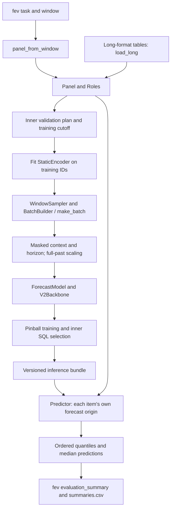

# Architecture

Demand Forecast trains a shared quantile model across a panel of time series.
Long-format tables and fev windows enter the same data, training, bundle and
prediction pipeline. That pipeline currently supports **v2 only**.

## Model families and scope

| Family key | Implementation | Status |
| --- | --- | --- |
| `v2` | `ForecastModel` with `V2Backbone` | Supported by the current settings, trainer, bundles, CLI and fev runner |
| `standard` | `AdvancedDemandForecastModel` | Legacy registry and input contract |
| `advanced` | `AdvancedDemandForecastModelV2` | Legacy model; distinct from the current v2 backbone |
| `lightweight`, `lightweight_tcn` | `LightweightDemandModel` | Legacy TCN implementation |
| `lightweight_mixer` | `LightweightMixerModel` | Legacy mixer implementation |

The current registry is in `demand_forecast/models/registry.py`;
`ModelConfig.family` accepts only `v2`. The other keys live in
`demand_forecast/models/wrapper.py`, remain on the legacy contract and are not
integrated into the shared pipeline. Legacy tuning, clustering and export code does not
make those features available through this pipeline. DHF is not integrated.
Full-history refitting and training separately for each fev window are also
unimplemented: `training.refit: full` and `--policy per_window` are rejected.

See the [frozen evaluation protocol](protocol.md) for benchmark rules,
[configuration guide](CONFIGURATION.md) for input settings, and
[settings schema](https://github.com/alessiosavi/demand-forecast/blob/main/demand_forecast/config/settings.py)
for accepted fields.

## End-to-end data flow

### 1. Load a panel with explicit roles

`run_fev` constructs a task, reads its windows and passes the past/future inputs
of each to `panel_from_window`. `Panel` holds ragged `Series` objects sharing a
frequency, seasonal period, target support and `Roles`. The roles distinguish
the target, known dynamic covariates, past-only dynamic covariates, categorical
statics and numeric statics.

The fev adapter preserves past-item order, joins future rows by ID, and reads
only known covariates from future rows. Each item's last past timestamp fixes
its history boundary, even when its final target is missing. Missing targets
remain NaN. Task profiles supply target support and categorical static roles;
the remaining declared statics are numeric. Task settings replace the base
data roles, frequency, horizon and quantiles while retaining its model and
training controls.

For user data, `load_long` reads CSV or Parquet and joins the configured ID
columns with a pipe separator, rejecting IDs that already contain that separator.
It validates timestamps against the frequency grid. Duplicate aggregation and
resampling are explicit settings. The default missing-target policy fills
absent historical rows with zero; explicit NaNs stay missing. Known covariates
may extend beyond history without moving its end. Parquet input needs pyarrow.

### 2. Reserve inner validation and fit preprocessing

`plan_inner_validation` reserves the last horizon before the resolved forecast
origin. A validation item needs enough observed prior targets (by default the
horizon plus eight), a finite positive full-past seasonal error, and at least
one observed validation label. Training labels stop before that holdout.

If no item qualifies, validation is marked as an exception, permitting training on all
history before the origin. `StaticEncoder` fits only IDs with observed targets
in the chosen training split; these IDs need not qualify for validation.
`val_items_max` can deterministically subsample validation items without changing
the training split or fitted IDs.

### 3. Build context, future inputs and labels

`build_origins` indexes candidate series/origin pairs with enough observed past
and at least one permitted label. `WindowSampler` draws one uniform origin per
eligible series in a seeded permutation each epoch. Its state records the epoch
and next draw position.

`BatchBuilder` caches grids, calendar features and encoded statics for a fixed
panel and encoder. `make_batch` is the convenience wrapper for a single build.
Each batch crops context to `max_context`, pads on the left, and creates the
requested horizon directly. `Batch.padding` is true at real positions, including
positions whose target is missing; `Batch.observed` identifies observed target
values. Covariate masks, static numeric masks and label masks are separate.
Unobserved values are zeroed in model inputs while their masks retain the
distinction from observed zeros. Labels beyond the training cutoff are masked.
Labels are carried for loss calculation and are not model inputs.

### 4. Scale, train and select

`sample_frame` takes its location from the observed context median (zero if
absent), but computes scale from the **whole permitted past**, even when context
is cropped. Raw scale is mean absolute seasonal-lag error, preserving missing
positions and excluding pairs with a missing endpoint. Weekly grids use lag
one; daily, hourly and monthly grids use seven, 24 and 12 respectively.

A sample is loss-eligible only when its raw scale is finite and positive and it
has an observed label. Eligible arithmetic floors scale at `1e-6`; an ineligible
frame uses scale one. Targets and labels share this affine frame.
`pinball_loss` averages doubled pinball loss over eligible observed cells and
quantile knots. An empty selection returns a graph-connected zero loss.

`Trainer` uses AdamW, a warmup/cosine learning-rate schedule and gradient clipping.
CUDA AMP uses native bfloat16 on compute capability 8.0 or newer, otherwise
float16 with gradient scaling; CPU training does not use AMP. Validation inputs
are prepared once per fit and scored in original units. Selection uses **inner
SQL**, keeping every absolute improvement; patience resets only for a relative
improvement exceeding `rel_tol`.

SQL divides doubled pinball errors by each item's full-past seasonal error,
discards non-finite **quotients**, pools cells per knot, then averages knots.
This differs from the training eligibility rule: finite error divided by infinite
scale contributes zero to SQL. A knot with no finite quotient makes SQL NaN.
Validation also reports MASE, WAPE, WQL, interval coverage/width and per-knot loss.

`resolve_budget` scales `base_steps` by fitted-series count divided by 2,000,
clips to a lower bound of the smaller of 500 and `base_steps` and an upper bound
of four times `base_steps`, then applies an optional `max_steps_cap`.
With no validation items, training uses this budget and the final state
(`exception_budget`). With no candidate origins it returns `no_training_data`
without optimizer steps. Ordinary completion restores the selected best state.

## Heterogeneous inputs and the v2 model

### Static categories, series IDs and numeric attributes

`StaticEncoder` builds a vocabulary for each categorical static and a separate
`__series__` vocabulary for series IDs. Code zero means unknown, code one means
missing, and observed training categories start at two. New IDs and unseen
categories therefore have a defined embedding slot when a bundle is reused.

`ForecastModel` owns one embedding table per vocabulary, each with width
`cat_emb_dim`. Numeric statics use training-set mean and population standard
deviation; constant columns use standard deviation one, and entirely missing
columns use mean zero and standard deviation one. Missing numeric values are
zeroed and accompanied by masks. A small softmax gate weights the categorical
embedding blocks and the combined numeric value/mask block before projection
to `d_model`.

### Continuous covariates and attention boundaries

The encoder projection receives normalized past targets, target-observed flags,
calendar features, known and past-only covariates, and covariate masks. The
decoder projection receives calendar features, known-future covariates and their
masks. These are linear projections of the concatenated channels, not separate
categorical embeddings for dynamic columns. Dynamic inputs must be numeric;
categories need indicator encoding.

`V2Backbone` applies static FiLM conditioning to encoder and decoder inputs,
pre-norm attention/feedforward layers, and gated static enrichment of encoder
memory. `hidden_continuous_size` sets the hidden width of that enrichment
network. RoPE rotates queries and keys at explicit positions: the last context
position is minus one and the first future position is zero, so left padding
does not shift real timestamps relative to the origin.

Encoder self-attention and every decoder cross-attention layer mask padded
memory keys. Fully masked attention rows produce zero output. Decoder
self-attention is bidirectional across the known future: a later planned
promotion can affect an earlier forecast. Future targets and future past-only
covariates never enter the decoder. The backbone returns one hidden state per
requested horizon step, without horizon interpolation. Patch embedding and
decomposition options are rejected by the current model configuration.

### Dynamic covariate guards

The dynamic-input guards added on 2026-11-01 use only finite values before the
sample origin to choose the transform. Non-finite source values are missing.

| Situation | Treatment |
| --- | --- |
| All finite past values are zero or one | Keep indicator values without standardization |
| Continuous column with observed past | Subtract its full-past mean and divide by population standard deviation; zero deviation uses one |
| Positive but very small deviation | Floor it at `1e-3` times the largest absolute past value |
| No finite past, but finite values in the requested slice | Mark the column cold and mask the entire context/future slice |
| Large transformed values | Clip valid values to ±`1e3` before float32 conversion |

Batch diagnostics count cold and floored sample/column pairs and clipped valid
values. Training and inference accumulate `cold_covariate_columns`,
`floored_covariate_columns` and `clipped_covariate_values`. These counters count
processing events, not distinct dataset columns. They expose cases where an
input is unavailable historically or nearly constant, rather than letting a
future value set its normalization.

### Ordered quantiles, support and fallbacks

`MonotoneQuantileHead` produces ordered quantiles around a free median using
cumulative positive increments: width factor times the probability gap times
softplus of the raw increment. The default width factor is two, and the knots
must include 0.5. Model output has batch, horizon and quantile axes.

`ForecastModel.predict` denormalizes once, applies fallbacks, then clamps to zero
only for nonnegative targets. Signed targets retain their negative values.

| Input at prediction time | Forecast behavior |
| --- | --- |
| Observed context and finite positive raw scale | Model quantiles in original units |
| Observed context but zero, undefined or non-finite raw scale | Empirical context quantiles, repeated over the horizon |
| No observed context, nonnegative target | All-zero forecast |
| No observed context, real-valued target | Saved `fallback_level`: median of observed training-split targets, or zero if none |

These choices allow ragged histories, missing attributes and unseen IDs to remain
in the forecast output. They do not make arbitrary non-finite targets safe:
the trainer skips non-finite losses and terminates after 20 consecutive such
losses, preserving a terminal checkpoint instead of publishing a new bundle.

### Why this matters for the weekly tasks

The seven bundled tasks have horizons from eight to 52 weeks. Their schemas mix
categorical identities, numeric attributes, prices, indicators and past-only
measurements. For example, Favorita declares promotions as known and oil prices
as past-only; Rossmann separates known promotions from past customer counts;
Walmart combines store/department/type categories with numeric size; hierarchical
sales declares no statics. Even without explicit static columns, series IDs have
their own embeddings.

Roles prevent unavailable future measurements from entering forecasts, masks
preserve missingness, and scale normalization lets one shared model train across
different target magnitudes. Frozen vocabularies and guarded covariates let later
windows reuse the first-window model without refitting preprocessing. These are
input and reproducibility properties, not a claim of benchmark accuracy.

## Bundles and prediction

`save_bundle` writes tensor weights, architecture/forecast configuration, fitted
static preprocessing, panel metadata and a versioned manifest. The manifest
records artifact hashes, package version, best-effort Git revision, training
cutoff and run provenance. `load_bundle` verifies version and hashes, rebuilds
the model and loads weights with tensor-only loading. The bundle stores metadata
about the panel, not its training observations.

`Predictor.from_bundle` loads on CPU by default. Prediction checks roles,
frequency, seasonality and target support, and rejects origins before the saved
`earliest_origin`. `forecast` returns one row per input series and forecast step:
`series_id`, `origin`, `timestamp`, one column per knot such as `q0.1`, and `point`
from the median. `forecast_arrays` returns IDs in input order and an array with
item, horizon and quantile axes.

## fev orchestration, identity and resume

`run_fev` implements `first_window`: train once per task and reuse that bundle
with each later window's expanded past. `window_origins` reads every item's first
future timestamp. `resolved_origin` uses their latest timestamp for training,
inner validation and run identity; the bundle's permissible origin floor is the
earliest timestamp in the first window.

`Predictor.forecast_per_item_origins` groups items by their own origins and
restores input order. An early-ending item can be forecast for calendar periods
already covered by other items' training or selection labels. Its own future
targets are withheld, but this is not an out-of-time evaluation relative to
every other series. The bundle's origin floor is a global constraint, not an
individual training cutoff for every item.

`predictions_for_fev` checks exact item coverage and reorders predictions to fev's
input order. The median is supplied under `predictions`; quantile keys are the
string forms of the knots. `run_fev` calls the task's `evaluation_summary` with
per-quantile scores, persisted timings and diagnostics, then replaces the row for
that task/model in `summaries.csv`. `run_baseline` uses seasonal naive and skips
existing task/model rows; changing baseline task data or definitions requires
a fresh output directory. `leaderboard` delegates to fev with 1,000 bootstrap
resamples and a configurable reference model.

`run_identity` is SHA-256 over sorted, compact UTF-8 JSON containing JSON-mode
settings, seed, dataset fingerprint, package version, resolved origin in ISO
format and task definition. Unset `training.max_steps_cap`,
`training.val_items_max` and `training.init_from`, and false `training.zero_shot`
and `training.eval_at_start`, are omitted from settings. A set `training.init_from`
is replaced by `{pretrain_identity, model_sha256}` from its bundle manifest. Git
revision is provenance, not an identity input.
User-data runs use a null task definition and hash the long/static file bytes
with length framing; fev runs use the task dataset fingerprint.

With `--resume`, existing run reports, checkpoints, bundles and saved windows
must match the identity. Checkpoints retain the live model, optimizer, scheduler,
AMP scaler, sampler state, Python/NumPy/Torch/CUDA random states, best model and
patience state, counters and timing history. Resume restores the random streams
after reconstructing the training objects. Completed bundles and windows can be
reused, and complete tasks retain their summary rows. When `--stop-after` stops
training before completion, it writes a checkpoint and progress report without
publishing a new bundle or completed-run report. Unexpected interruptions can
resume from the last successfully written checkpoint, if one exists. A terminal
non-finite checkpoint remains terminal on resume.

Telemetry includes cumulative training/evaluation/checkpoint seconds, session
count, peak allocated CUDA bytes, non-finite losses, scaler skips and the
covariate counters. Evaluation snapshots add step, elapsed time, training seconds
per step and evaluation seconds. Progress retains the last three snapshots.
Prediction windows persist inference time, device, fallback and covariate counts.
Missing diagnostics in older prediction windows are read as unknown. Summary
covariate totals sum available measurements and stay unknown when none were
recorded; required timing/fallback totals stay unknown if any window lacks them.
A legacy checkpoint without a scaler-skip total also retains an unknown total.

### Written artifacts

Training paths below are relative to the `train --out` directory, or to the
task-named directory under `fev run --out-dir`. Window indices start at zero.

| Stage | Artifact | Contents and publication |
| --- | --- | --- |
| Input adaptation, validation plan, encoding, sampling | No separate files | In-memory panel, split, vocabularies and batches; fitted state and plan are retained in the later artifacts |
| Training/checkpoint or termination | `checkpoints/progress.json` | Identity, current step/budget, split counts, stop reason, device/AMP, cumulative timings and recent telemetry |
| Training checkpoint | `checkpoints/latest.pt` | Live training state and best state for resume; includes a `timings.json` member inside the Torch ZIP archive |
| Successful completion, including no training data | `run.json` | Settings, identity, split, outcome, budget, timings, telemetry and provenance |
| Bundle publication | `bundle/model.pt` | Selected model state, including the fallback-level buffer |
| Bundle publication | `bundle/config.json` | Family, backbone arguments, forecast/data settings and model dimensions |
| Bundle publication | `bundle/encoder.json` | Fitted vocabularies, numeric statistics and static-column order |
| Bundle publication | `bundle/panel.json` | Roles, frequency, seasonality, target support, training cutoff, earliest origin and fallback level |
| Bundle publication | `bundle/manifest.json` | Version, hashes, provenance and embedded run report |
| Each completed fev prediction window | `window_0.npz`, `window_1.npz`, … (`window_*.npz`) | IDs, quantile arrays, identity and prediction diagnostics |
| Each completed fev model or baseline task | `summaries.csv` at the output root | Official evaluation summary rows keyed by task/model |
| Long-panel forecast | User-selected `--out` CSV | One row per series and horizon step, with original-unit quantiles and median |

A run with no candidate training origins writes progress, a bundle and a run
report but need not write a checkpoint. Reports, checkpoints, prediction files
and summaries use temporary files followed by replacement; bundle publication
stages its artifacts together before replacing the directory.

## Command-line interface

The executable is `demand-forecast`. This is the command surface defined in
`demand_forecast/cli.py`; all commands also accept `--help`. Options in the
optional column have defaults.

| Command | Required arguments/options | Optional options |
| --- | --- | --- |
| `train` | `--config`, `--out` | `--resume` |
| `forecast` | `--bundle`, `--config`, `--origin`, `--out` | None |
| `fev run` | `--config`, `--out-dir` | `--tasks`, `--policy`, `--profiles`, `--resume`, `--model-name`, `--stop-after` |
| `fev baseline` | `--out-dir` | `--tasks`, `--profiles`, `--verbose` / `-v` |
| `fev leaderboard` | Positional summary CSV | `--baseline` |
| `generate-data` | Positional output path | `--days`, `--products`, `--stores`, `--seed`, `--verbose` / `-v`, `--format`, `--freq`, `--start` |
| `generate-sales` | `--products`, `--output` / `-o` | `--start`, `--end`, `--seed`, `--promo-share`, `--verbose` / `-v` |
| `version` | None | None |

Training and forecasting commands require long-panel settings. fev execution
requires the optional benchmark dependencies. Its task selector accepts
`weekly`, `heldout`, comma-separated weekly names, or a task YAML; `--profiles`
overrides the target-support/static-role profiles. `--policy` defaults to
`first_window`; `per_window` is recognized but rejected. `--stop-after` interrupts
after that many training steps in the current call, saving a checkpoint if
training has not already finished. `fev baseline` is resumable without a resume
flag. `fev leaderboard` defaults to the `seasonal_naive` reference model.

`generate-data` defaults to sales-format CSV; `--format long` instead writes
`long.csv` and `static.csv` in an output directory. In long format, `--days`
counts grid steps and `--products` counts series. `generate-sales` reads a
product catalogue and generates daily sales. See the
[README quick start](https://github.com/alessiosavi/demand-forecast#quick-start)
for a complete small CPU example.
